# QNeuro Forge

**Re-check, sign and verify a quantum-kernel study: every number from Team Morphos's Bloq hackathon entry on heart-failure survival, recomputed by code and sealed with post-quantum signatures.**

  

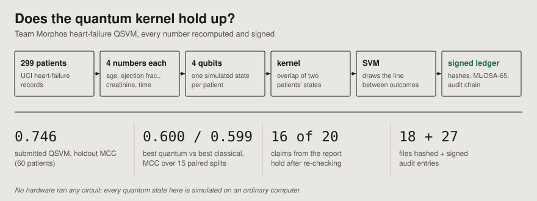

**Source:** https://github.com/Vilsee/QNeuro-Forge

> **In one paragraph.** Team Morphos built a quantum-kernel support vector machine (QSVM) on the Bloq platform to predict death in 299 heart-failure patients, and submitted a holdout MCC of **0.746** on 60 patients. This repository asks a plainer question: which of our own claims survive a re-check? **16 of 20** claims hold, the quantum kernel is **statistically tied** with the best classical model (0.600 against 0.599 MCC over 15 paired splits), and every file and every analysis step is hashed and signed so anyone can verify it. Nothing here claims a quantum advantage, and nothing here is a clinical tool.

## Contents

1. [Open these during the demo](#1-open-these-during-the-demo)
2. [The result in 60 seconds](#2-the-result-in-60-seconds)
3. [Background for non-specialists](#3-background-for-non-specialists)
4. [The data](#4-the-data)
5. [What was run: six experiments](#5-what-was-run-six-experiments)
6. [Findings, one at a time](#6-findings-one-at-a-time)
7. [The claim checker](#7-the-claim-checker)
8. [How it works](#8-how-it-works)
9. [Security and verification](#9-security-and-verification)
10. [The page and the walkthrough](#10-the-page-and-the-walkthrough)
11. [Run it yourself](#11-run-it-yourself)
12. [Repository layout](#12-repository-layout)
13. [Reproducibility notes](#13-reproducibility-notes)
14. [Limitations](#14-limitations)
15. [Explaining it to the professor](#15-explaining-it-to-the-professor)
16. [Glossary](#16-glossary)
17. [References](#17-references)

---

## 1. Open these during the demo

| What | Link | Why show it |
| --- | --- | --- |
| Local site | `qneuro study serve --port 8080`, then http://127.0.0.1:8080/ | The whole study as a page. Run the command from the repository root. |
| Source code | https://github.com/Vilsee/QNeuro-Forge | The commit history shows the study layer, the tests and the signed outputs. |
| Bloq platform, Experiments page | https://platform.bloq.in/?m=experiments | Where E1 and E2 were run. Show the experiment list and the algorithm and device choices. |
| Bloq coverage: no-code platform launch | https://quantumcomputingreport.com/bloq-quantum-launches-no-code-platform-to-accelerate-algorithm-development/ | Independent description of what the platform is for. |
| Bloq coverage: platform launch | https://thequantuminsider.com/2026/05/07/bloq-quantum-launches-easy-to-use-platform-to-simplify-quantum-computing-use-case-development/ | The same launch from a second outlet. |
| Bloq coverage: IBM Quantum Network | https://thequantuminsider.com/?p=2385279 | Context on the hardware access behind the platform. |
| Dataset page (UCI) | https://archive.ics.uci.edu/dataset/519/heart-failure-clinical-records | The public data: 299 patients, CC BY 4.0, citation and variable list. |
| Dataset paper | https://doi.org/10.1186/s12911-020-1023-5 | Chicco and Jurman (2020), where the data was introduced. |
| Why MCC | https://bmcgenomics.biomedcentral.com/articles/10.1186/s12864-019-6413-7 | Chicco and Jurman (2020): the argument for MCC over accuracy and F1. |
| NIST standard for the signature | https://nvlpubs.nist.gov/nistpubs/FIPS/NIST.FIPS.204.pdf | FIPS 204, the ML-DSA standard used to sign the study. |
| Fair cross-validation test | https://papers.nips.cc/paper/1661-inference-for-the-generalization-error | Nadeau and Bengio, the corrected test the Honesty Guard uses. |

More links are in [References](#17-references).

---

## 2. The result in 60 seconds

| Question | Answer from the code |
| --- | --- |
| Does the submitted QSVM result reproduce? | Yes. The five class-based holdout metrics match the submitted file to nine decimals, with the same confusion matrix [[36, 5], [2, 17]]. ROC-AUC differs by 0.0013. |
| Which kernel is it? | An angle-embedding kernel with no entanglement. A true ZZ kernel on the same inputs gives holdout MCC 0.672. |
| Is the quantum model better than classical? | Not demonstrably. Over 15 paired cross-validation splits the best quantum kernel scores 0.600 MCC and the best classical model (XGBoost) 0.599. Guard verdict: `NO_DIFFERENCE`. |
| How reliable is the 60-patient holdout? | One changed prediction moves MCC between 0.702 and 0.790. Two move it between 0.659 and 0.834. |
| Does the follow-up time feature matter? | Alone it scores AUROC 0.812. Replacing it with serum sodium lowers MCC for every model by 0.164 to 0.229. |
| Why did the Bloq runs E1 and E2 collapse? | Unknown. Local ZZ kernels on inputs in 0 to 1 never predicted 'no deaths' in 300 random splits, so split luck does not explain it. Kernel concentration at wide input ranges is a hypothesis. |
| What was edited before submission? | Three text fields, shown in section 6.7. Every number is identical. |
| Can anyone verify this? | Yes. 18 files are hashed in a signed manifest, the study is signed with ML-DSA-65, and 27 audit entries are hash-chained. One command checks it all and a second tries to break it. |

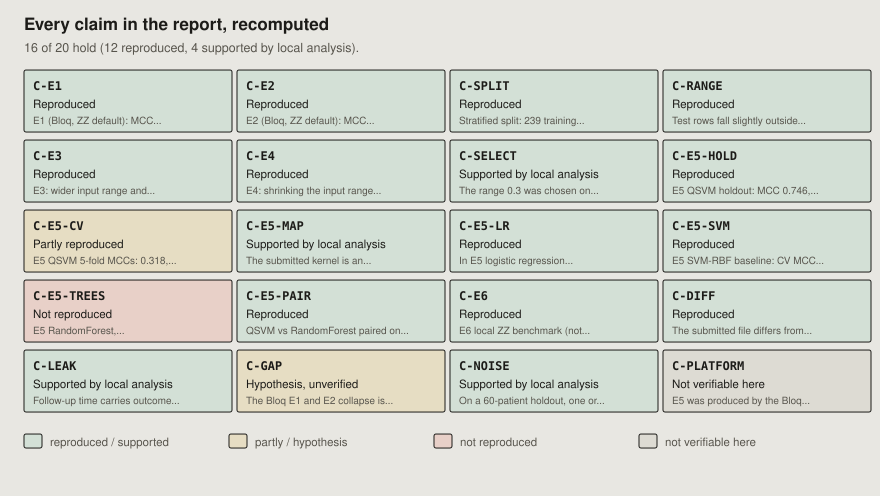

---

## 3. Background for non-specialists

### 3.1 The task

A hospital recorded 13 numbers for each of 299 heart-failure patients and whether the patient died during follow-up (`death_event`). The task is classification: from a few of those numbers, predict who died. This is a research exercise on a public dataset. It is not a tool for deciding anything about a real patient.

### 3.2 Why MCC and not accuracy

About 32% of the training patients died, so a model that answers "survived" for everyone is about 68% accurate and useless. The Matthews correlation coefficient (MCC) scores a prediction from all four cells of the confusion matrix and equals 0 for no skill and 1 for perfect prediction, whatever the class balance. Experiment E1 shows why it matters: Bloq reported accuracy 0.6875 but MCC 0.0000, because the model predicted "survived" for all 48 patients.

```
MCC = (TP x TN - FP x FN) / sqrt( (TP+FP) (TP+FN) (TN+FP) (TN+FN) )
```

### 3.3 What a quantum kernel SVM is

An SVM separates two groups using a similarity measure called a kernel. A *quantum kernel* computes that similarity from quantum states: each patient's numbers set up the state of four qubits, and the similarity of two patients is how much their states overlap. The SVM itself is the ordinary classical algorithm. No quantum advantage is assumed anywhere in this project; the question is only whether the quantum similarity measure does better than classical models, and by how much.

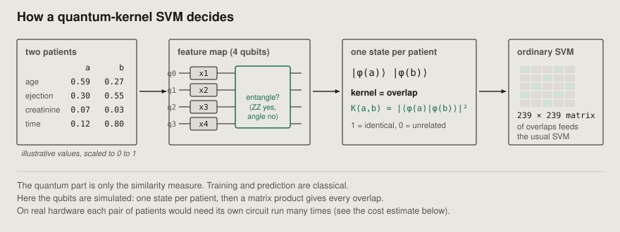

### 3.4 Two kernels that are easy to confuse

The submitted result was labelled as a ZZ feature map in the platform's own export. Re-implementing it showed that the numbers come from an angle-embedding kernel instead. The difference matters because only the ZZ circuit entangles the qubits.

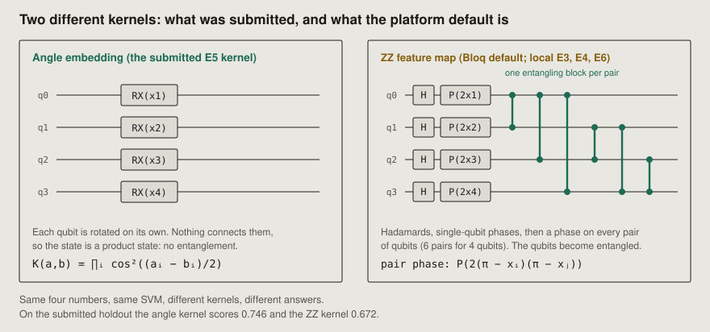

### 3.5 Why a simulator, and what real hardware would cost

All circuits here are simulated on an ordinary computer: one state per patient, then a matrix product gives every overlap. On real hardware, every pair of patients needs its own circuit run, repeated for many shots. Counting pairs for this dataset:

| Quantity | Arithmetic | Value |
| --- | --- | --- |
| Training pairs for the kernel matrix | 239 x 238 / 2 | 28,441 |
| Holdout-versus-training pairs | 60 x 239 | 14,340 |
| One fit and one holdout prediction | 28,441 + 14,340 | 42,781 circuits |
| One 5-fold cross-validation pass (about 191 train, 48 test per fold) | 5 x (18,145 + 9,168) | 136,565 circuits |
| Shots at 1,000 per circuit, fit and holdout only | 42,781 x 1,000 | 42,781,000 shots |

This is why the study stays on a simulator, and why a hardware run would be a project of its own.

---

## 4. The data

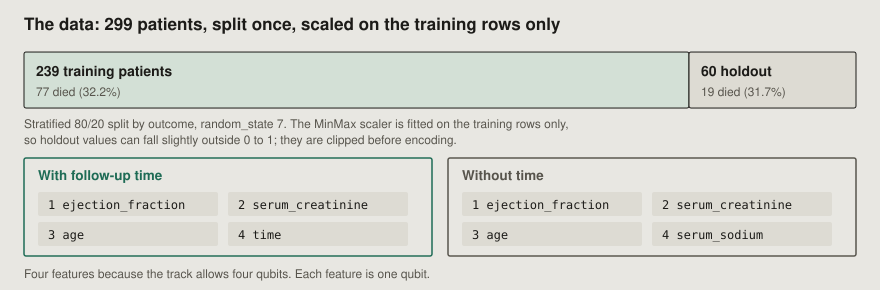

- **Source:** UCI Machine Learning Repository, dataset 519, Heart Failure Clinical Records, 299 patients, CC BY 4.0.
- **Split:** one stratified 80/20 split by outcome, `random_state=7`: 239 training patients (77 died) and 60 holdout patients (19 died).
- **Scaling:** a MinMax scaler fitted on the training rows only. Holdout values can therefore leave 0 to 1 slightly, and are clipped before encoding.
- **Four features, one per qubit:** the track allows four qubits. The *with time* set uses ejection fraction, serum creatinine, age and follow-up time. The *no time* set swaps time for serum sodium.
- **Files:** the four prepared CSVs sit in [`data/morphos/original/`](data/morphos/original/) exactly as submitted. `qneuro study prepare` rebuilds them from UCI and prints their SHA-256 hashes.

---

## 5. What was run: six experiments

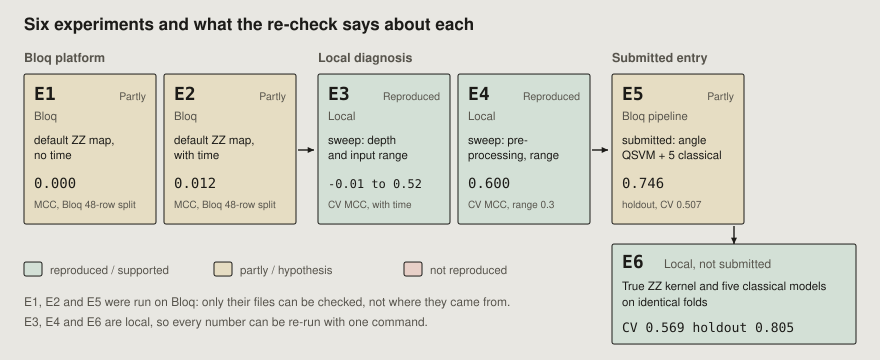

| Id | What | Where | Data | CV MCC | Holdout MCC | Re-check |
| --- | --- | --- | --- | --- | --- | --- |
| E1 | Bloq platform, QSVM with the default ZZ feature map, 4 qubits, depth 1 | Bloq | no time (serum sodium) | - | 0.000 | Partly reproduced |
| E2 | Same platform settings, with follow-up time | Bloq | with time | - | 0.012 | Partly reproduced |
| E3 | Local sweep over depth and input range, true ZZ kernel | Local | both | - | - | Reproduced |
| E4 | Local sweep over preprocessing and range, repeated 5-fold CV | Local | both | 0.600 | 0.805 | Reproduced |
| E5 | Bloq pipeline export: angle-embedding QSVM and five classical models | Bloq pipeline | with time | 0.507 | 0.746 | Partly reproduced |
| E6 | Local true-ZZ QSVM and five classical models on identical folds | Local | with time | 0.569 | 0.805 | Reproduced |

E1 and E2 report Bloq's own 48-row validation split, not the 60-patient holdout. E4 reports the best cross-validated range. Experiments E1, E2 and E5 were run on the Bloq platform and can only be checked as files. E3, E4 and E6 are local and re-run with one command.

---

## 6. Findings, one at a time

### 6.1 The submitted QSVM result reproduces

An independent angle-embedding kernel, written in NumPy and checked against PennyLane's `AngleEmbedding` in the test suite, reproduces the submitted holdout. Five class-based metrics match to nine decimals and the confusion matrix is identical. ROC-AUC differs by 0.0013 because the score function differs. Four of five cross-validation folds match exactly. Fold 4 is 0.617 here against 0.632 in the file, and the cause is not known.

| Metric | Ours | Submitted |
| --- | --- | --- |
| mcc | 0.745976 | 0.745976 |
| accuracy | 0.883333 | 0.883333 |
| f1 | 0.829268 | 0.829268 |
| precision | 0.772727 | 0.772727 |
| recall | 0.894737 | 0.894737 |
| roc_auc | 0.934531 | 0.933248 |

### 6.2 The baselines in the submitted file

| Model | CV MCC | Holdout MCC | Reproduced here? |
| --- | --- | --- | --- |
| QSVM (Quantum Kernel) | 0.507 | 0.746 | reproduced (independent kernel) |
| LogisticRegression | 0.000 | 0.191 | reproduced |
| RandomForest | 0.629 | 0.778 | not reproduced |
| GradientBoosting | 0.575 | 0.778 | not reproduced |
| SVM-RBF | 0.525 | 0.778 | reproduced |
| XGBoost | 0.611 | 0.656 | not reproduced |

Two details change how to read this table. Logistic regression collapses to the majority class only when its inputs are multiplied by 0.3, which the reproduction found by trial; on the full 0 to 1 range it scores CV 0.548 and holdout 0.746, equal to the QSVM's holdout. So beating that baseline says little. The three tree models do not reproduce with default settings and seed 42.

### 6.3 A fair comparison: same splits, same budget, one judge

All eight models were scored on the same 15 paired splits (5-fold, 3 repeats) of the 239 training patients, and the scores went to the project's Honesty Guard, which is the only code allowed to word a quantum-advantage claim.

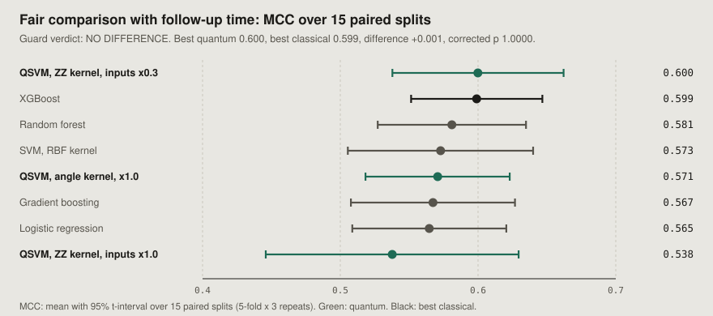

| Model | Kind | MCC | 95% t-interval | AUROC |
| --- | --- | --- | --- | --- |
| QSVM, ZZ kernel, inputs x0.3 | quantum | 0.600 | 0.538 to 0.662 | 0.874 |
| XGBoost | classical | 0.599 | 0.551 to 0.647 | 0.884 |
| Random forest | classical | 0.581 | 0.527 to 0.635 | 0.904 |
| SVM, RBF kernel | classical | 0.573 | 0.505 to 0.640 | 0.875 |
| QSVM, angle kernel, x1.0 | quantum | 0.571 | 0.518 to 0.623 | 0.871 |
| Gradient boosting | classical | 0.567 | 0.508 to 0.627 | 0.870 |
| Logistic regression | classical | 0.565 | 0.509 to 0.621 | 0.863 |
| QSVM, ZZ kernel, inputs x1.0 | quantum | 0.538 | 0.446 to 0.629 | 0.872 |

> Observed MCC delta of +0.0009 between qsvm_zz_x0.3 (0.5999) and xgboost (0.5990) with bootstrap 95% CI [-0.0611, +0.0653] and Nadeau-Bengio corrected p = 1.0000 across 3 quantum configurations does not reject the null hypothesis at threshold 0.02. No conclusive advantage demonstrated.

Without follow-up time the picture is the same: the best quantum configuration scores 0.414 and the best classical model 0.417, verdict `NO_DIFFERENCE`.

<details><summary>Same table without follow-up time</summary>

| Model | Kind | MCC | 95% t-interval | AUROC |
| --- | --- | --- | --- | --- |
| Random forest | classical | 0.416 | 0.339 to 0.494 | 0.787 |
| QSVM, ZZ kernel, inputs x1.0 | quantum | 0.414 | 0.341 to 0.486 | 0.762 |
| QSVM, ZZ kernel, inputs x0.3 | quantum | 0.396 | 0.336 to 0.457 | 0.791 |
| Gradient boosting | classical | 0.385 | 0.305 to 0.465 | 0.760 |
| SVM, RBF kernel | classical | 0.378 | 0.307 to 0.449 | 0.786 |
| XGBoost | classical | 0.377 | 0.321 to 0.432 | 0.762 |
| Logistic regression | classical | 0.336 | 0.261 to 0.410 | 0.776 |
| QSVM, angle kernel, x1.0 | quantum | 0.034 | −0.022 to 0.089 | 0.786 |

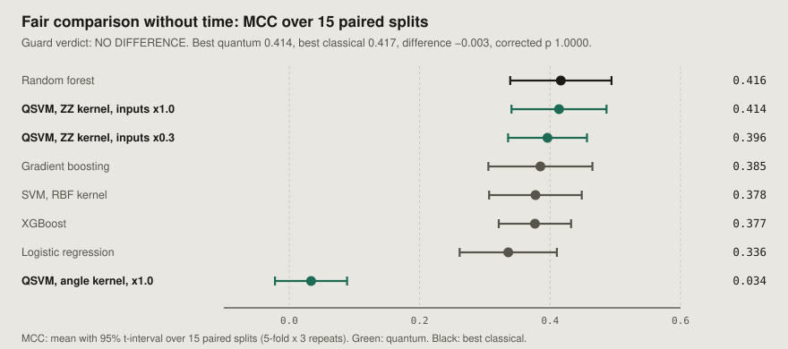

</details>

### 6.4 The 60-patient holdout is fragile

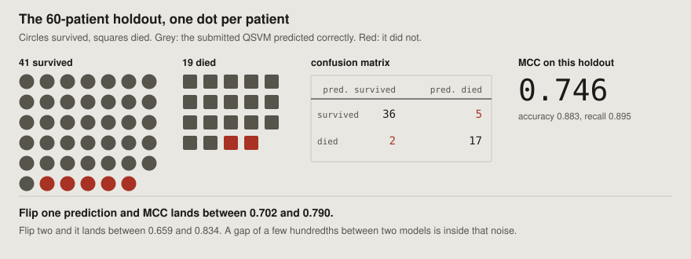

Flipping one prediction moves MCC between 0.702 and 0.790. Flipping two moves it between 0.659 and 0.834. Gaps of a few hundredths between models on this holdout are noise. That is why the input range was chosen by cross-validation and not by the holdout: Across five ranges (with time) CV MCC varies by 0.076 but holdout MCC varies by 0.162.

### 6.5 Follow-up time carries the outcome

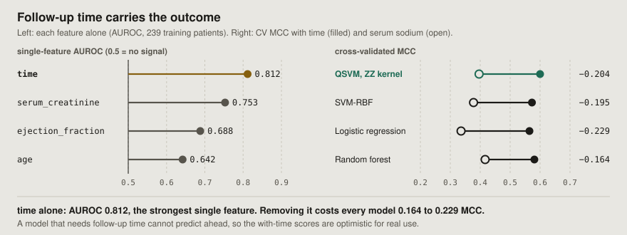

| Feature (with-time set) | AUROC alone | Direction |
| --- | --- | --- |
| ejection_fraction | 0.688 | lower value, more deaths |
| serum_creatinine | 0.753 | higher value, more deaths |
| age | 0.642 | higher value, more deaths |
| time | 0.812 | lower value, more deaths |

| Model | MCC with time | MCC without | Change | AUROC with | AUROC without |
| --- | --- | --- | --- | --- | --- |
| QSVM (ZZ kernel, inputs x 0.3) | 0.600 | 0.396 | −0.204 | 0.874 | 0.791 |
| SVM-RBF | 0.573 | 0.378 | −0.195 | 0.875 | 0.786 |
| LogisticRegression | 0.565 | 0.336 | −0.229 | 0.863 | 0.776 |
| RandomForest | 0.581 | 0.416 | −0.164 | 0.904 | 0.787 |

`time` is how long a patient was followed, and patients who die are followed for less time, so a model that needs it cannot predict ahead. The track allows it. The with-time numbers are therefore optimistic for any real use. Without-time runs put serum_sodium in the place of time; the folds are the same 15 repeated 5-fold splits. The submitted report listed this comparison as future work; it was run here locally and not on Bloq.

### 6.6 Why the Bloq runs collapsed, and what can and cannot be said

E1 (no time) and E2 (with time) used the platform's default ZZ feature map on four qubits and scored MCC 0.0000 and 0.0116. The local sweep shows that a ZZ kernel does collapse when its inputs are stretched:

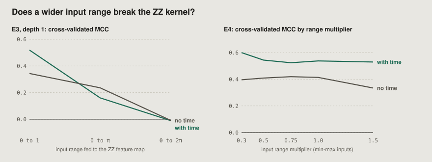

<details><summary>Sweep tables (E3 depth 1, E4 min-max)</summary>

**E3, depth 1**

| Data | Input range | CV MCC | Holdout MCC |
| --- | --- | --- | --- |
| with time | 0 to 1 | 0.519 | 0.672 |
| with time | 0 to π | 0.160 | 0.233 |
| with time | 0 to 2π | −0.011 | 0.008 |
| no time | 0 to 1 | 0.343 | 0.402 |
| no time | 0 to π | 0.235 | 0.319 |
| no time | 0 to 2π | −0.009 | 0.131 |

**E4, min-max inputs, repeated 5-fold**

| Data | Range multiplier | CV MCC | Holdout MCC |
| --- | --- | --- | --- |
| with time | 0.3 | 0.600 | 0.805 |
| with time | 0.5 | 0.544 | 0.746 |
| with time | 0.75 | 0.524 | 0.834 |
| with time | 1.0 | 0.538 | 0.672 |
| with time | 1.5 | 0.529 | 0.716 |
| no time | 0.3 | 0.396 | 0.447 |
| no time | 0.5 | 0.409 | 0.258 |
| no time | 0.75 | 0.419 | 0.327 |
| no time | 1.0 | 0.414 | 0.402 |
| no time | 1.5 | 0.334 | 0.157 |

</details>

But collapse at wide ranges does not explain the platform runs, because those inputs were in 0 to 1. With inputs in 0 to 1 the local ZZ kernel predicted **no deaths in 0 of 300 random splits** without time and 0 of 300 with time, and its MCC was at most 0.05 in 0.3% of the no-time splits (mean 0.392, 5th to 95th percentile 0.180 to 0.597). Split luck is ruled out. Whether the platform rescales inputs internally cannot be checked from outside, so it stays a hypothesis. E2's saved title says "notime" although its features include time, a labelling slip in the platform entry.

### 6.7 What was edited before submission

Three text fields differ between the Bloq pipeline export and the submitted file. Every number is identical.

| Field | Bloq export (before) | Submitted (after) |
| --- | --- | --- |
| `/metadata/leakage_audit_note` | Regulatory-aware clinical pipeline: evaluates cohort with follow-up time. Benchmark demonstrated that time inflates MCC scores significantly across both quantum and classical baselines. | This run includes follow-up time, which the track permits. Follow-up time can carry outcome information and would not be available at true prediction time, so reported MCC may be higher than for a deployable model. No no-time comparison is included in this file. |
| `/metadata/quantum_configuration/feature_map` | ZZFeatureMap (Angle Embedding product state fidelity) | Angle Embedding fidelity kernel (product-state, no entanglement) |
| `/statistical_comparison/verdict` | Validation benchmark completed. Follows regulatory guidelines reporting confidence intervals and rigorous holdout metrics. | QSVM holdout MCC is comparable to the classical models. Its 5-fold CV MCC is lower than RandomForest's, but the difference is not statistically significant (p = 0.112). |

The original note claimed that follow-up time inflates MCC across models, which the file had never tested, and it named a ZZ map although the kernel that reproduces the numbers has no entanglement.

---

## 7. The claim checker

Each claim in the submitted report is recomputed and given one of six statuses.


| Status | Meaning |
| --- | --- |
| Reproduced | Code re-ran it, or recomputed it from the stored file, and the value matches. |
| Supported by local analysis | An inference the local runs back up. |
| Partly reproduced | Most of it matches; one part does not. |
| Not reproduced | Default settings do not give the stored value. |
| Hypothesis, unverified | A plausible explanation that the evidence does not settle. |
| Not verifiable here | No outside tool can check it. |

<details><summary>All 20 claims with recomputed values</summary>

| Id | Status | Claim | Recomputed value |
| --- | --- | --- | --- |
| C-E1 | Reproduced | E1 (Bloq, ZZ default): MCC 0.0000; 0 of 48 patients predicted to die. | MCC recomputed from the platform confusion matrix [[33, 0], [15, 0]]: 0.0000; accuracy 0.6875. |
| C-E2 | Reproduced | E2 (Bloq, ZZ default): MCC 0.0116; 3 of 48 patients predicted to die. | MCC recomputed from the platform confusion matrix [[31, 2], [14, 1]]: 0.0116; accuracy 0.6667. |
| C-SPLIT | Reproduced | Stratified split: 239 training and 60 test patients with matching death rates. | 239 train (death rate 0.322), 60 test (death rate 0.317, 19 deaths). |
| C-RANGE | Reproduced | Test rows fall slightly outside [0, 1] because the scaler only saw training rows. | Test feature minimum -0.094, maximum 1.047. The study clips test rows to [0, 1] before encoding. |
| C-E3 | Reproduced | E3: wider input range and deeper circuits hurt the ZZ kernel (8 rows of the report table). | 8 of 8 rows match to the report's two decimals. Example: withtime range 0 to 1 depth 1 gives CV 0.5190 and test 0.6716. |
| C-E4 | Reproduced | E4: shrinking the input range to 0.3 helped the with-time data (CV 0.60, test 0.81). | 4 of 4 cells match. With time: range 0.3 CV 0.5999 / test 0.8055; range 1.0 CV 0.5377 / test 0.6716. |
| C-SELECT | Supported by local analysis | The range 0.3 was chosen on cross-validation, not on the holdout. | Across five ranges (with time) CV MCC varies by 0.076 but holdout MCC varies by 0.162. |
| C-E5-HOLD | Reproduced | E5 QSVM holdout: MCC 0.746, accuracy 0.883, recall 0.895, confusion [[36, 5], [2, 17]]. | Independent angle-embedding kernel gives MCC 0.745976, accuracy 0.8833, confusion [[36, 5], [2, 17]]. ROC-AUC 0.9345 against 0.9332 submitted (score function differs). |
| C-E5-CV | Partly reproduced | E5 QSVM 5-fold MCCs: 0.318, 0.359, 0.514, 0.633, 0.711 (mean 0.507). | 4 of 5 folds match. Mean 0.5036 against 0.5068. Fold 4: 0.6167 against 0.6325. |
| C-E5-MAP | Supported by local analysis | The submitted kernel is an angle-embedding fidelity kernel with no entanglement, not a ZZ feature map. | The product-state kernel reproduces the submitted holdout exactly (MCC 0.746). A true ZZ kernel at the same range gives holdout MCC 0.672. |
| C-E5-LR | Reproduced | In E5 logistic regression predicted the majority class in every fold (CV MCC 0.000, holdout 0.191). | Reproduced when the inputs are multiplied by 0.3: CV 0.0000, holdout 0.1912. On the full 0 to 1 range the same model gets CV 0.5483 and holdout 0.7460, which equals the QSVM's holdout MCC. |
| C-E5-SVM | Reproduced | E5 SVM-RBF baseline: CV MCC 0.525, holdout 0.779. | CV 0.5250, holdout 0.7785. |
| C-E5-TREES | Not reproduced | E5 RandomForest, GradientBoosting and XGBoost baseline numbers. | RandomForest: CV 0.6074 vs 0.6291, holdout 0.6806 vs 0.7785; GradientBoosting: CV 0.5876 vs 0.5752, holdout 0.7328 vs 0.7785; XGBoost: CV 0.5775 vs 0.6112, holdout 0.6321 vs 0.6559 |
| C-E5-PAIR | Reproduced | QSVM vs RandomForest paired on E5 folds: delta MCC -0.122, 95% CI [-0.290, 0.045], p = 0.112. | Delta -0.1223, CI [-0.2895, +0.0449], t -2.031, p 0.1121. |
| C-E6 | Reproduced | E6 local ZZ benchmark (not submitted): QSVM CV MCC 0.569, holdout 0.806. | Fresh run against the stored file: 0 differing class-based values (timing excluded). QSVM CV 0.5688, holdout 0.8055. Largest ROC-AUC difference 0.0004. |
| C-DIFF | Reproduced | The submitted file differs from the original Bloq-pipeline export in three text fields only. | 3 fields differ: /metadata/leakage_audit_note, /metadata/quantum_configuration/feature_map, /statistical_comparison/verdict. Every number is identical. |
| C-LEAK | Supported by local analysis | Follow-up time carries outcome information, so with-time scores are optimistic for a deployable model. | `time` alone has AUROC 0.812, higher than any other single feature (best other: serum_creatinine 0.753). Swapping it for serum_sodium changes CV MCC by: QSVM +0.204, SVM-RBF +0.195, LogisticRegression +0.229, RandomForest +0.164. |
| C-GAP | Hypothesis, unverified | The Bloq E1 and E2 collapse is explained by kernel concentration at large input ranges (report, E3). | Local ZZ kernels on 0 to 1 inputs never predicted 'no deaths' in 300 random 191/48 splits (no-time: 0, with-time: 0), and MCC was at most 0.05 in 0.3% of no-time splits. Local collapse appears only at range 0 to 2pi. |
| C-NOISE | Supported by local analysis | On a 60-patient holdout, one or two patients move MCC noticeably. | Baseline 0.746. One prediction flipped: 0.702 to 0.790. Two flipped: 0.659 to 0.834. |
| C-PLATFORM | Not verifiable here | E5 was produced by the Bloq platform pipeline. | No platform signature or run identifier in the file can be checked from outside Bloq. |

</details>

---

## 8. How it works

### 8.1 Architecture

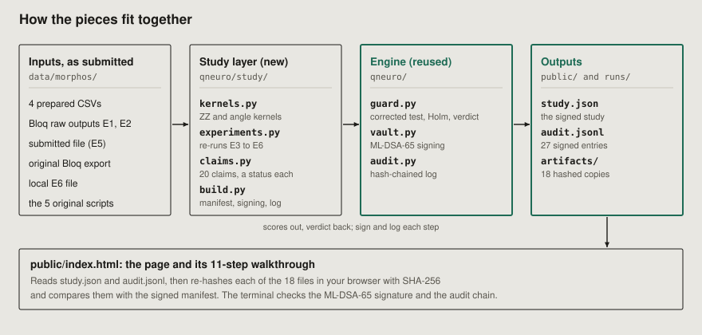

| Module | Role |
| --- | --- |
| `qneuro/study/kernels.py` | ZZ feature map and angle-embedding kernel in NumPy. A test checks the angle kernel against PennyLane. |
| `qneuro/study/experiments.py` | Re-runs E3 to E6, the leakage study, the platform-gap study and the guard runs. Class-based E6 metrics must match the stored file exactly. ROC-AUC may differ by 0.0005 because it depends on library versions. |
| `qneuro/study/claims.py` | Turns every claim in the report into a recomputed value and a status. |
| `qneuro/study/build.py` | Hashes 18 files into a manifest, signs the study and writes the audit log. Also holds `verify` and `tamper_demo`. |
| `qneuro/guard.py` | The Honesty Guard from the original engine. |
| `qneuro/vault.py`, `qneuro/audit.py` | ML-DSA-65 signing and the hash-chained audit log from the original engine. |

### 8.2 What `qneuro study build` does

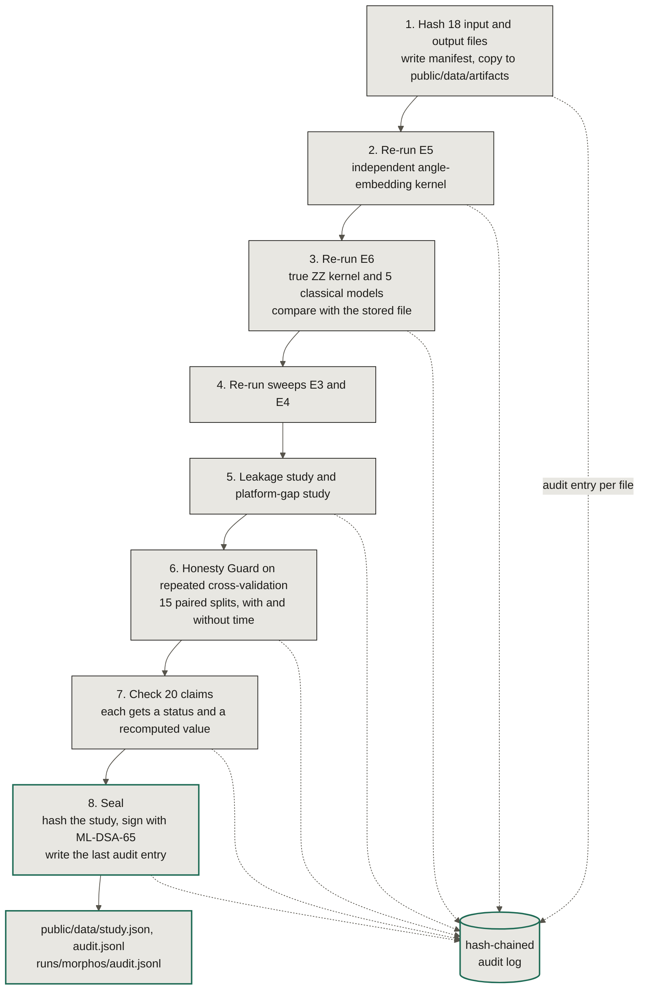

The build recorded 27 audit entries: 18 x INGEST_ARTIFACT, 1 x REPRODUCE_E5, 1 x REPRODUCE_E6, 1 x SWEEP_E3_E4, 1 x LEAKAGE_AND_GAP, 1 x DIFF_SUBMISSION, 1 x GUARD_VERDICT_WITHTIME, 1 x GUARD_VERDICT_NOTIME, 1 x CLAIMS_CHECKED, 1 x SIGN_STUDY.

### 8.3 The Honesty Guard

The guard scores a comparison between quantum configurations and classical models on paired cross-validation splits. It chooses the best classical model by mean score, tests every quantum configuration against it with the Nadeau-Bengio corrected resampled t-test (which accounts for overlapping training sets), and applies Holm correction across all quantum configurations tried, because choosing the best of several looks better than it is.

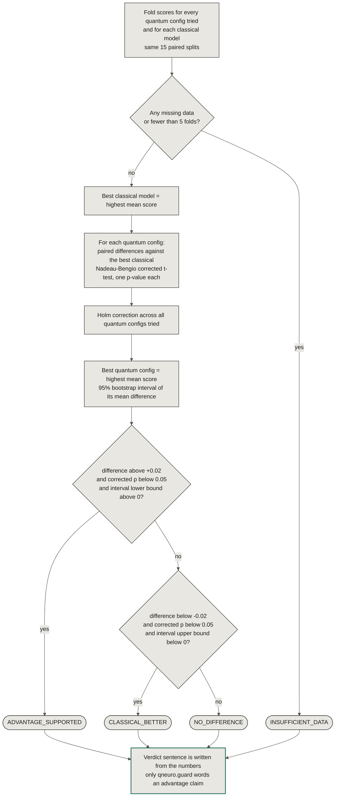

The interval in the verdict is a bootstrap interval of the mean fold difference. The 15 splits overlap, so that interval is optimistic on its own, which is why the verdict also requires the corrected p-value.

---

## 9. Security and verification

### 9.1 What is signed and why

- **ML-DSA-65** (NIST FIPS 204, a post-quantum signature standard) signs the whole study. Results about patients stay relevant for decades, and signatures made today with classical algorithms could be forged later by a quantum computer.
- **SHA-256 manifest:** every input and output file has its hash inside the signed study, so changing any file is detected.
- **Hash-chained audit log:** every analysis step is an entry that stores the previous entry's hash and its own signature. Editing any entry breaks the chain from that point.

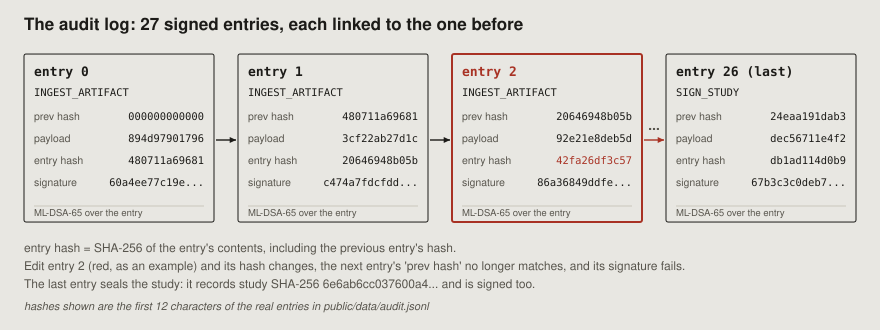

### 9.2 What `qneuro study verify` checks

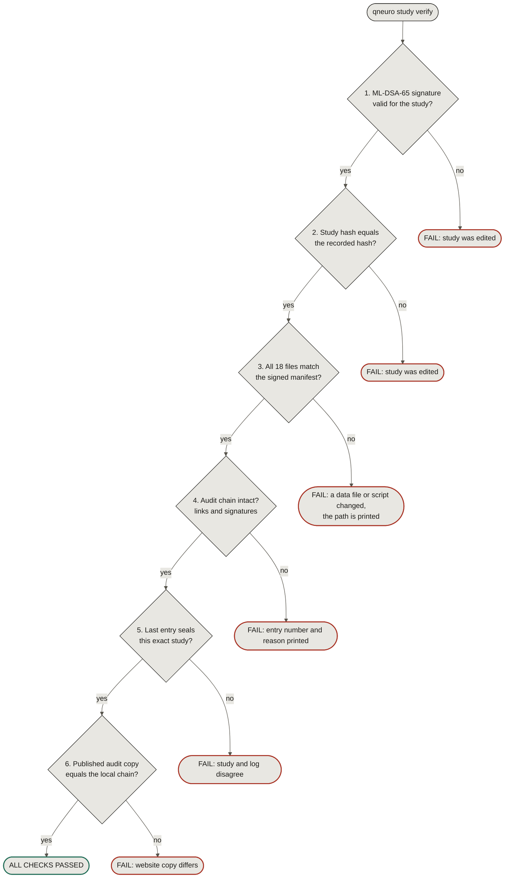

### 9.3 The browser check and the tamper demo

The page re-hashes each file with the browser's own crypto and compares it with the signed manifest. A second button corrupts one digit of the submitted file in memory so the mismatch is visible.

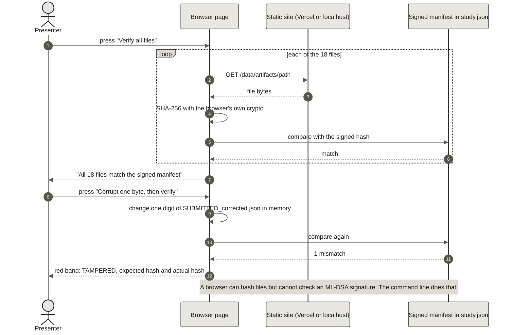

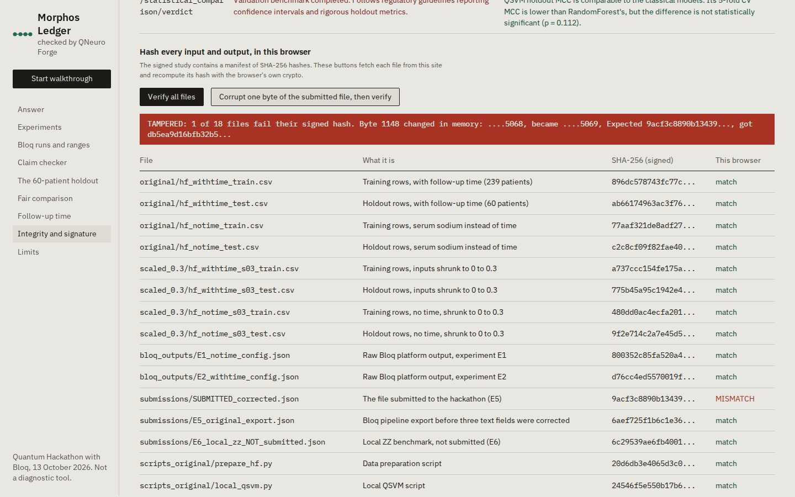

On the command line, `qneuro study tamper-demo` changes one digit in a copy of the submitted file and one digit in a copy of the signed study. Both edits are detected and an untouched control passes.

### 9.4 Threat model

| What could go wrong | What catches it |
| --- | --- |
| A number in the submitted file is edited after the fact | The file's SHA-256 no longer matches the signed manifest. |
| A number inside the study is edited | The ML-DSA-65 signature fails. |
| An analysis step is edited or removed from the log | The hash chain breaks at that entry, and the sealing entry no longer matches the study. |
| The website copy differs from the repository copy | `qneuro study verify` compares the published audit log with the local chain, and the browser re-hashes every served file. |
| Line endings change on checkout (Windows) | `.gitattributes` stores hashed files byte for byte, so hashes survive a clone. |

### 9.5 What this does not prove

The tool signs and hashes what it is given. It cannot show that the Bloq platform produced a number: keep the platform's experiment ids and screenshots. The post-quantum libraries ([`kyber-py`](https://github.com/GiacomoPope/kyber-py) and [`dilithium-py`](https://github.com/GiacomoPope/dilithium-py)) are pure-Python reference implementations, unaudited and not constant-time, so they demonstrate the pattern and are not production security.

---

## 10. The page and the walkthrough

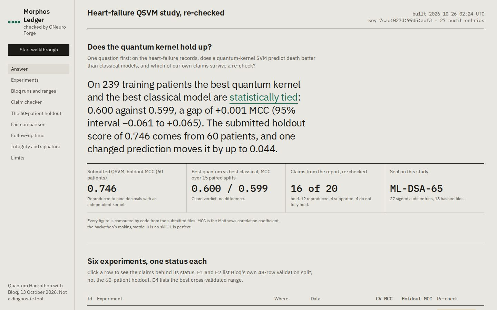

The page is a static site in [`public/`](public/) that reads `public/data/study.json`. Press **Start walkthrough** for 11 steps. Each shows what is on screen and the sentence to say aloud, and some perform the click for you. The numbers in the narration are filled from the signed study.

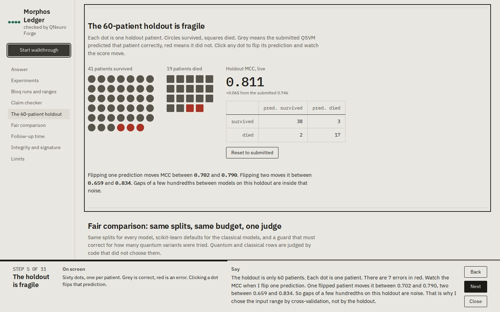

```mermaid
%%{init: {"theme":"base","themeVariables":{"primaryColor":"#E8E7E2","primaryTextColor":"#1C1B18","primaryBorderColor":"#1C1B18","lineColor":"#57544C","secondaryColor":"#DDDBD3","tertiaryColor":"#E8E7E2","edgeLabelBackground":"#E8E7E2","clusterBkg":"#E8E7E2","clusterBorder":"#CAC7BC","noteBkgColor":"#DDDBD3","noteTextColor":"#1C1B18","actorBkg":"#E8E7E2","actorBorder":"#1C1B18","actorTextColor":"#1C1B18","signalColor":"#57544C","signalTextColor":"#1C1B18","labelBoxBkgColor":"#DDDBD3","labelBoxBorderColor":"#1C1B18","labelTextColor":"#1C1B18","loopTextColor":"#1C1B18","activationBkgColor":"#D3E0D6","activationBorderColor":"#1E6B55","sequenceNumberColor":"#E8E7E2","fontFamily":"ui-sans-serif, system-ui, Segoe UI, Helvetica, Arial, sans-serif"}}}%%
flowchart TB
  subgraph W["Browser: 11 walkthrough steps, about 8 minutes"]
    direction LR
    W1["Steps 1 and 2<br/>answer, experiments"] --> W2["Steps 3 and 4<br/>Bloq runs, claims"] --> W3["Steps 5 to 7<br/>holdout, fair comparison,<br/>follow-up time"] --> W4["Steps 8 to 10<br/>edit diff, hash check,<br/>signature"] --> W5["Step 11<br/>limits"]
  end
  subgraph T["Terminal: 4 commands, about 4 minutes, run after step 10"]
    direction LR
    T1["qneuro study<br/>reproduce"] --> T2["qneuro study<br/>verify"] --> T3["qneuro study<br/>tamper-demo"] --> T4["qneuro audit"]
  end
```

<details><summary>More screenshots</summary>

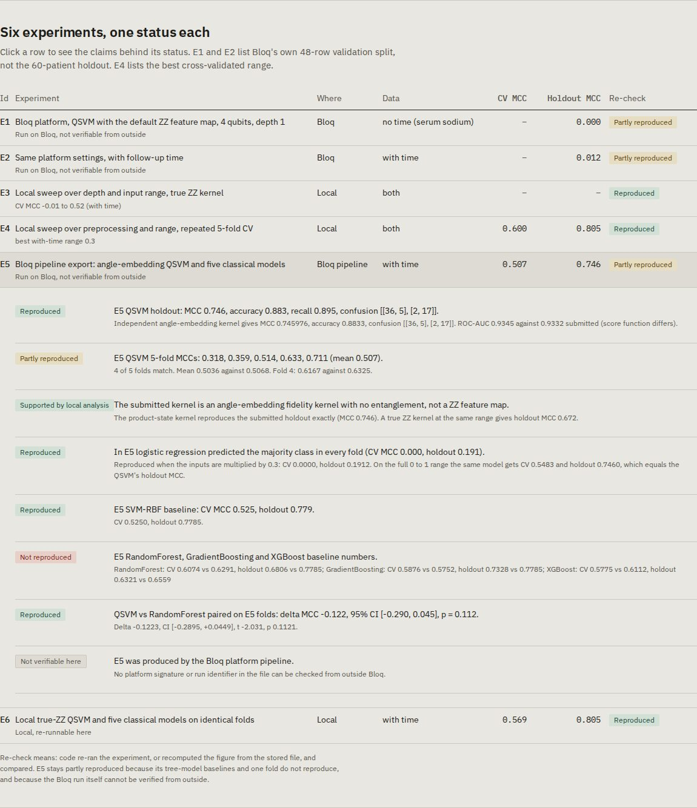

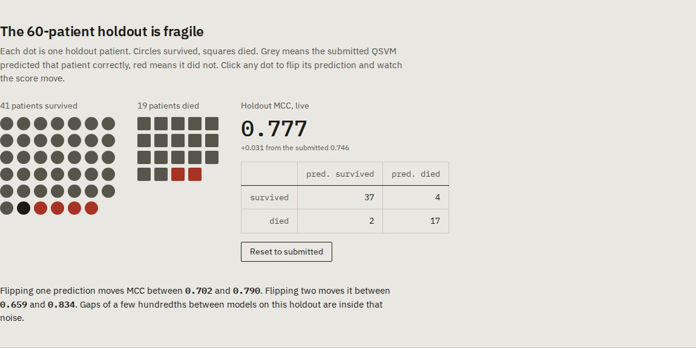

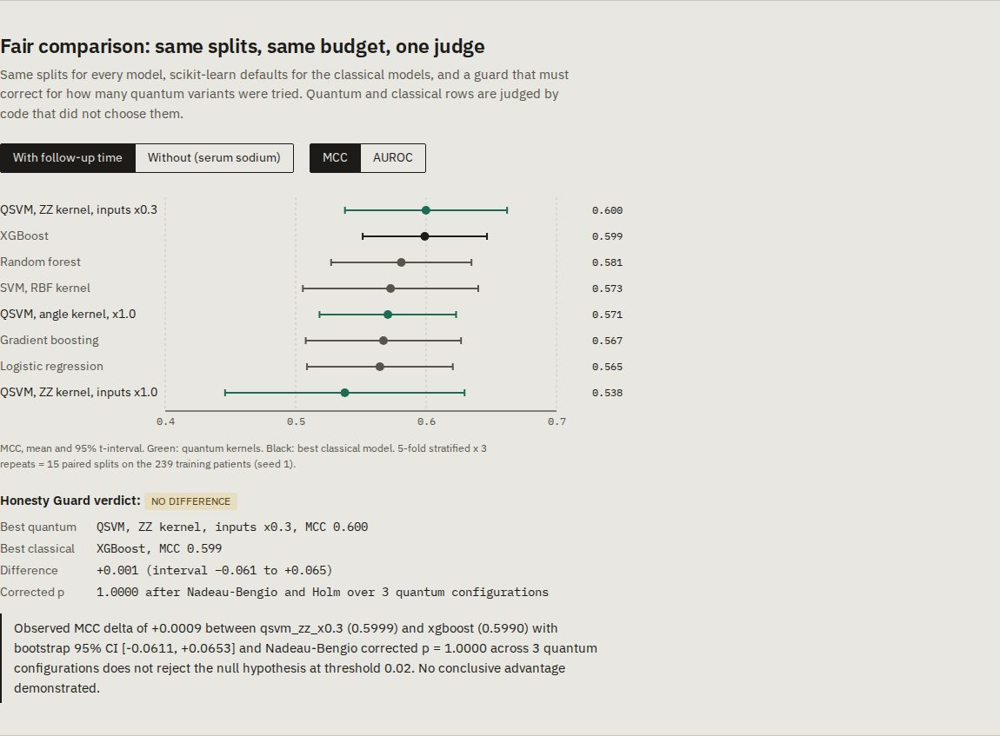

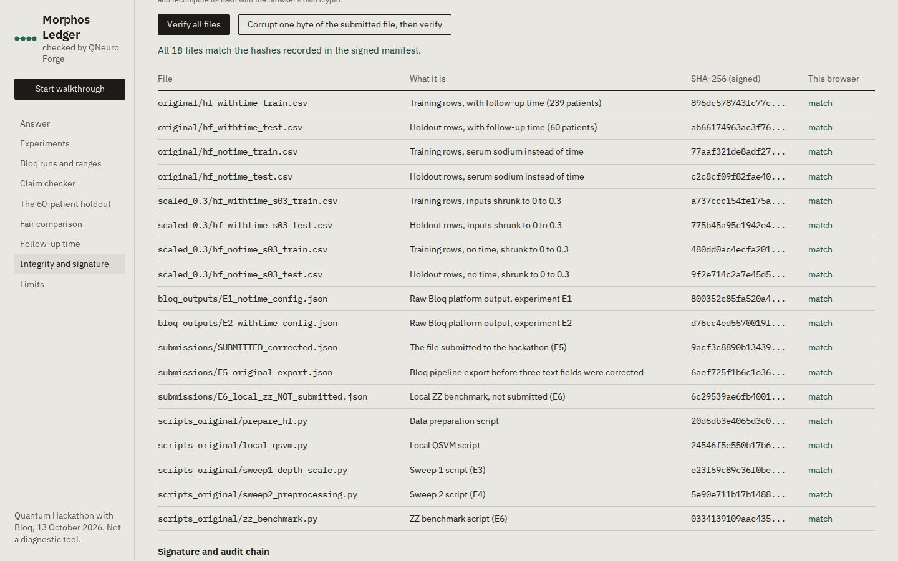

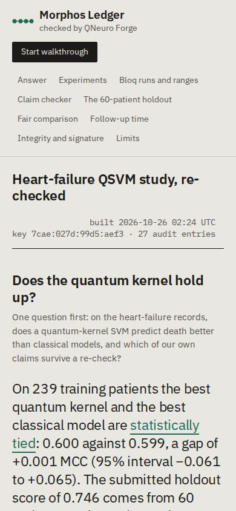

</details>

The full spoken script, including questions to expect, is in [`docs/DEMO_SCRIPT.md`](docs/DEMO_SCRIPT.md).

---

## 11. Run it yourself

### Windows PowerShell

```powershell
git clone https://github.com/Vilsee/QNeuro-Forge
cd QNeuro-Forge
powershell -ExecutionPolicy Bypass -File .\scripts\setup.ps1     # venv, install, tests, rebuild and sign the study
.\.venv\Scripts\Activate.ps1
qneuro study verify
qneuro study serve --port 8080                                   # http://127.0.0.1:8080/
```

### macOS or Linux

```bash
git clone https://github.com/Vilsee/QNeuro-Forge && cd QNeuro-Forge
python3 -m venv .venv && source .venv/bin/activate
pip install -e ".[dev,study,demo]" && python -m playwright install chromium
pytest -q
qneuro study build && qneuro study verify
qneuro study serve --port 8080
```

### Commands

| Command | What it does |
| --- | --- |
| `qneuro study build` | Re-runs E3 to E6, the leakage study and the guard, checks the claims, signs the result and writes `public/data/` and `runs/morphos/audit.jsonl`. `--fast` skips the sweeps. |
| `qneuro study verify` | Checks the signature, the study hash, every artifact hash, the audit chain and the sealing entry. |
| `qneuro study tamper-demo` | Changes one digit in a copy of the submission and a copy of the study. Both must be detected. |
| `qneuro study reproduce` | Live re-run of the submitted QSVM (E5) and the local ZZ benchmark (E6). |
| `qneuro study prepare` | Rebuilds the four CSVs from UCI dataset 519 and prints their SHA-256 hashes. |
| `qneuro study serve` | Serves `public/` locally, the same files Vercel serves. |
| `qneuro audit --audit-file runs/morphos/audit.jsonl` | Verifies and summarises the audit chain. |
| `python demo/run_demo.py` | Plays the browser walkthrough with Playwright. `--pace 1.3` is slower, `--manual` lets you drive. |
| `scripts/demo.ps1 -Browser` | The terminal half of the demo with pauses, then the browser half. |
| `python scripts/make_figures.py`, `make_screenshots.py`, `make_readme.py` | Regenerate this README's figures, screenshots and numbers after a rebuild. |

The original engine commands (`qneuro run`, `verify`, `serve`, `tamper-demo`) still work and are unchanged.

### Tests

```bash
pytest -q
```

`tests/test_study.py` re-runs real experiments: E6 must match the stored file, the E5 holdout metrics must match, the angle kernel must equal PennyLane's `AngleEmbedding`, and a tampered study must fail verification.

---

## 12. Repository layout

```
QNeuro-Forge/
  data/morphos/            the submitted files, exactly as handed in
    original/              4 prepared CSVs (with time, no time; train, test)
    scaled_0.3/            the same four, inputs shrunk to 0 to 0.3
    bloq_outputs/          raw Bloq output for E1 and E2
    submissions/           submitted file, original Bloq export, local E6 file
    scripts_original/      the 5 hackathon scripts
  qneuro/
    study/                 kernels, experiments, claims, build (new)
    guard.py vault.py audit.py ...   the original engine
  public/                  static site served by Vercel
    index.html study/      the page, its styles and script
    data/                  signed study.json, audit.jsonl, hashed artifact copies, walkthrough
    pipeline-demo.html     the earlier synthetic-cohort dashboard (a test fixture, not a result)
  runs/morphos/            the audit chain written by the build
  demo/                    Playwright walkthrough runner
  docs/                    this README's figures, diagrams and screenshots, the demo script, the original report
  scripts/                 setup, demo, figure and README generators
  tests/                   pytest suite
```

---

## 13. Reproducibility notes

- **Environment:** the signed study was built with Python 3.12.10, NumPy 2.5.4, scikit-learn 1.9.1 and SciPy 1.18.1.
- **Tolerance:** class-based metrics and fold scores must match exactly on any machine. ROC-AUC means may move in the last digit between library versions, so the E6 comparison allows 0.0005. On one tested Windows setup the GradientBoosting ROC-AUC mean differed by 0.0004.
- **Line endings:** `.gitattributes` marks `data/morphos/`, `public/data/` and `runs/` as `-text`, so Git never converts them. Without it a Windows clone would change the bytes and fail the hash check.
- **Keys:** `qneuro study build` creates a signing key under `.qneuro/keys/` (never committed). The public key is embedded in `study.json`, so anyone can verify without it.
- **Seeds:** the split uses `random_state=7`, the cross-validation folds seed 42 (E5, E6), seed 0 (E3) and seed 1 (E4 and the guard runs).

---

## 14. Limitations

1. Everything quantum is a classical simulation. No hardware ran any circuit and no noise is modelled.
2. The holdout has 60 patients. Differences of a few hundredths in MCC are noise there.
3. That E5 was produced on the Bloq platform cannot be verified by any tool outside the platform.
4. The tree-model baselines in the submitted file do not reproduce with default settings. E1 and E2 are reproduced only as arithmetic on the raw platform outputs.
5. The cross-validation protocol picks the best of three quantum variants. Holm correction reduces the selection effect but does not replace a locked test set.
6. The bootstrap interval in the guard's sentence treats the 15 overlapping splits as independent and is therefore optimistic. The corrected p-value is the stricter part of the verdict.
7. The cohort is one hospital pair in Faisalabad, Pakistan (105 women, 194 men, NYHA class III or IV). Results do not carry over to other populations by default.
8. The post-quantum libraries are unaudited demonstration code.
9. This is research tooling. It is not a diagnostic tool and must not inform clinical decisions.

---

## 15. Explaining it to the professor

**Two-minute version.**

1. *The question.* Does a quantum-kernel SVM predict heart-failure death better than classical models, and which of our own claims survive a re-check?
2. *The answer.* On 239 training patients the best quantum kernel and the best classical model are tied: 0.600 against 0.599 MCC. The submitted 0.746 comes from 60 patients, where one changed prediction moves it by about 0.044.
3. *What reproduced.* The submitted holdout result, exactly, with an independent kernel. The kernel has no entanglement, unlike its label in the export.
4. *What did not.* The tree-model baselines, one cross-validation fold, and the explanation for the Bloq collapse, which is only a hypothesis.
5. *Why trust this.* Every file is hashed, the study is signed with a post-quantum signature, every step is in a hash-chained log, and two commands plus one button in the browser check all of it, including a deliberate corruption.

<details><summary>Questions to expect, with answers</summary>

**What is a quantum kernel SVM, in one breath?**

Each patient's four numbers are turned into the state of four qubits. The kernel is how much two patients' states overlap. A normal SVM then uses that overlap as its similarity measure. Here the qubits are simulated on an ordinary computer.

**Why MCC and not accuracy?**

About 32% of patients died, so a model that says 'survived' for everyone is 68% accurate. E1 did exactly that: accuracy 0.6875, MCC 0.000. MCC is 0 for no skill and 1 for perfect, whatever the class balance.

**Why did the Bloq runs E1 and E2 fail?**

I do not know. My sweep shows the ZZ kernel collapses when inputs are stretched to 0 to 2 pi. But with inputs in 0 to 1 the local ZZ kernel never predicted 'no deaths' in 300 random splits. So I call the range explanation a hypothesis. Whether the platform rescales inputs internally cannot be checked from outside.

**Is the quantum model better than the classical ones?**

Not demonstrably. On 15 paired splits the best quantum kernel and the best classical model are tied, 0.600 against 0.599 MCC. The submitted holdout MCC of 0.746 is on 60 patients, where flipping one prediction moves it between 0.702 and 0.790.

**You edited the submitted file. Why?**

Three text fields: the feature-map name, a leakage note and a verdict sentence. Every number is identical, and the diff is on screen. The original note said time inflates MCC across models, which the file never tested, and it named a ZZ map although the kernel that reproduces the numbers has no entanglement.

**How do you know the submitted kernel is not ZZ?**

An independent angle-embedding kernel reproduces the submitted holdout metrics exactly, to nine decimals, with the same confusion matrix. A true ZZ kernel at the same input range gives holdout MCC 0.672. Two kernels, one match.

**Can you prove the run happened on Bloq?**

No, and the tool says so. It can sign and hash what I give it. It cannot attest to where a number came from. I keep the experiment ids and screenshots from the platform.

**Why does one cross-validation fold not reproduce?**

Fold 4 is 0.617 in my run and 0.633 in the file, a gap of 0.016 MCC. The other four folds and the holdout match exactly. I do not know the cause, and the claim table marks it as partly reproduced.

**The tree-model baselines do not reproduce either?**

Right. Logistic regression and the RBF SVM in the submitted file reproduce exactly, logistic regression only when inputs are multiplied by 0.3, which is why it collapsed to the majority class. RandomForest, GradientBoosting and XGBoost do not reproduce with default settings and seed 42. The platform's settings for them are not visible to me.

**What is wrong with the time feature?**

It is how long a patient was followed, and patients who die are followed for less time. Alone it scores AUROC 0.812, higher than any other single feature. Replacing it with serum sodium lowers MCC for every model by 0.164 to 0.229. The track allows it, but a model that needs it cannot predict ahead.

**Why a corrected t-test and why Holm?**

Cross-validation folds share training patients, so a plain paired t-test is overconfident. The Nadeau-Bengio correction widens the variance. Holm corrects for trying three quantum variants, because picking the best of several looks better than it is.

**What is ML-DSA and why use it here?**

A NIST post-quantum signature standard, FIPS 204. Results about patients stay relevant for decades, and signatures made today with classical algorithms could be forged later by a quantum computer. The library is a pure-Python reference implementation, unaudited, so this shows the pattern and is not production security.

**Would this run on real quantum hardware?**

Not tried. A hardware kernel needs one circuit per pair of patients. For 239 training patients that is 239 x 238 / 2 = 28,441 circuits for the training matrix and 60 x 239 = 14,340 more for the holdout, 42,781 in total, each repeated for shots. The simulator needs one state per patient and a matrix product.

**Is this usable clinically?**

No. It is research tooling on a public dataset of 299 patients from one pair of hospitals in Faisalabad, Pakistan. It is not a diagnostic tool.

**What would you do next?**

Run the no-time comparison on the Bloq platform, lock a holdout before choosing anything, find out whether the platform rescales inputs, and run a small hardware job.

</details>

---

## 16. Glossary

| Term | Meaning |
| --- | --- |
| Classification | Predicting a category (died or survived) from numbers. |
| Confusion matrix | A 2 by 2 count of correct and wrong predictions: true negatives, false positives, false negatives, true positives. |
| MCC | Matthews correlation coefficient. 0 is no skill, 1 is perfect. Uses all four confusion-matrix cells. |
| AUROC | Area under the ROC curve: the chance that a randomly chosen patient who died is scored higher than one who survived. 0.5 is no signal. |
| Kernel | A similarity score between two data points. An SVM can use any valid kernel. |
| QSVM | A support vector machine whose kernel is computed from quantum states. |
| Feature map | The circuit that turns a patient's numbers into a quantum state. |
| ZZ feature map | A feature map with Hadamards, phases and an entangling block on every pair of qubits. |
| Angle embedding | A feature map with one rotation per qubit and no entanglement. |
| Entanglement | A quantum correlation between qubits that a product state does not have. |
| Cross-validation | Repeatedly training on part of the data and testing on the rest to estimate performance. |
| Holdout | A final set of patients kept aside and used once. Here, 60 patients. |
| Data leakage | Information in the inputs that reveals the answer, making scores look better than real use. |
| Nadeau-Bengio test | A paired t-test corrected for the overlap between cross-validation training sets. |
| Holm correction | A step-down method that controls the chance of any false positive across many tests. |
| SHA-256 | A fingerprint of a file: any change gives a different fingerprint. |
| ML-DSA-65 | A NIST post-quantum digital signature algorithm (FIPS 204). |
| Hash chain | A log where each entry includes the previous entry's hash, so editing one entry breaks all later links. |
| Manifest | The signed list of every file and its hash. |
| Playwright | A tool that drives a real browser from code. Used here to play the walkthrough. |

---

## 17. References

**Data and the original study**

- UCI Machine Learning Repository, Heart Failure Clinical Records (id 519): https://archive.ics.uci.edu/dataset/519/heart-failure-clinical-records (DOI https://doi.org/10.24432/C5Z89R, CC BY 4.0)
- Chicco D, Jurman G. Machine learning can predict survival of patients with heart failure from serum creatinine and ejection fraction alone. BMC Medical Informatics and Decision Making 20, 16 (2020): https://doi.org/10.1186/s12911-020-1023-5
- `ucimlrepo`, the package that downloads UCI datasets: https://github.com/uci-ml-repo/ucimlrepo
- The Team Morphos report and PRD: [`docs/MORPHOS_REPORT_AND_PRD.md`](docs/MORPHOS_REPORT_AND_PRD.md)

**Bloq**

- Bloq platform: https://platform.bloq.in/?m=experiments
- Quantum Computing Report, no-code platform launch: https://quantumcomputingreport.com/bloq-quantum-launches-no-code-platform-to-accelerate-algorithm-development/
- The Quantum Insider, platform launch: https://thequantuminsider.com/2026/05/07/bloq-quantum-launches-easy-to-use-platform-to-simplify-quantum-computing-use-case-development/
- The Quantum Insider, IBM Quantum Network: https://thequantuminsider.com/?p=2385279
- Product Hunt: https://www.producthunt.com/products/bloq-quantum

**Quantum kernels**

- Qiskit `ZZFeatureMap`: https://quantum.cloud.ibm.com/docs/en/api/qiskit/qiskit.circuit.library.ZZFeatureMap
- PennyLane `AngleEmbedding`: https://docs.pennylane.ai/en/stable/code/api/pennylane.AngleEmbedding.html
- scikit-learn `SVC` (used with a precomputed kernel): https://scikit-learn.org/stable/modules/generated/sklearn.svm.SVC.html

**Statistics**

- Chicco D, Jurman G. The advantages of the Matthews correlation coefficient (MCC) over F1 score and accuracy in binary classification evaluation. BMC Genomics 21, 6 (2020): https://bmcgenomics.biomedcentral.com/articles/10.1186/s12864-019-6413-7
- Nadeau C, Bengio Y. Inference for the generalization error. Machine Learning 52, 239-281 (2003), DOI https://doi.org/10.1023/A:1024068626366; conference version: https://papers.nips.cc/paper/1661-inference-for-the-generalization-error
- Holm S. A simple sequentially rejective multiple test procedure. Scandinavian Journal of Statistics 6(2), 65-70 (1979).

**Post-quantum cryptography**

- NIST FIPS 204, Module-Lattice-Based Digital Signature Standard (ML-DSA): https://nvlpubs.nist.gov/nistpubs/FIPS/NIST.FIPS.204.pdf
- Overview of the finalized NIST standards (FIPS 203, 204, 205): https://cloudsecurityalliance.org/articles/nist-fips-203-204-and-205-finalized-an-important-step-towards-a-quantum-safe-future
- `dilithium-py` (ML-DSA, pure Python): https://github.com/GiacomoPope/dilithium-py and https://pypi.org/project/dilithium-py/
- `kyber-py` (ML-KEM, pure Python): https://github.com/GiacomoPope/kyber-py and https://pypi.org/project/kyber-py/

**Tools**

- Playwright for Python: https://playwright.dev/python/
- Mermaid (the flowcharts in this README): https://mermaid.js.org/
- Vercel (hosting for `public/`): https://vercel.com/docs

*Built for the Quantum Hackathon with Bloq at Karunya, 13 October 2026. Research prototype. Not a diagnostic tool.*
